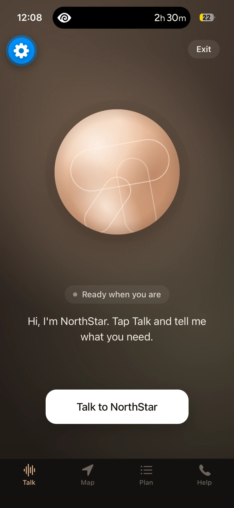
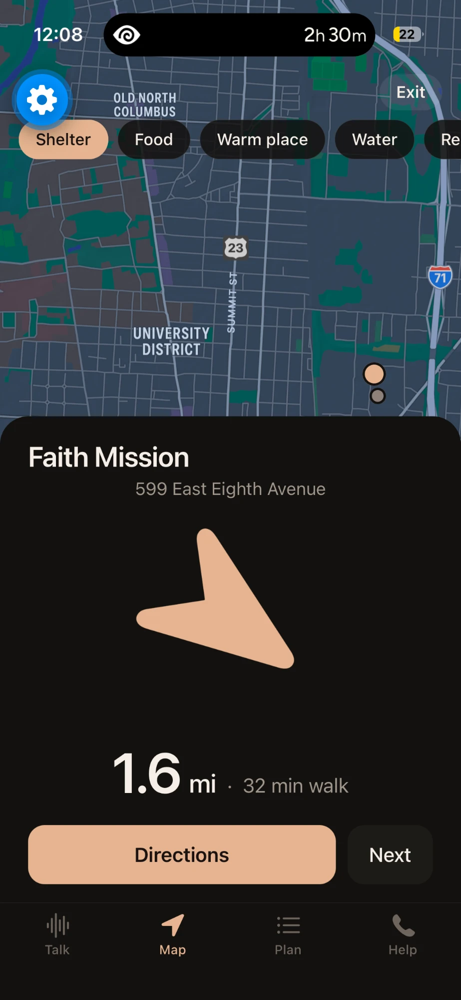
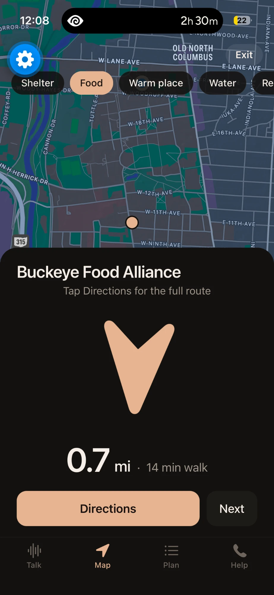
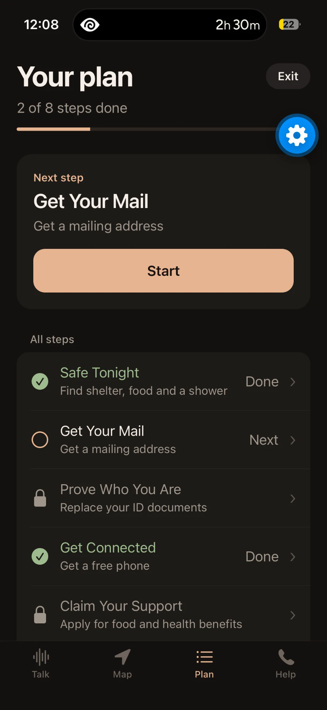
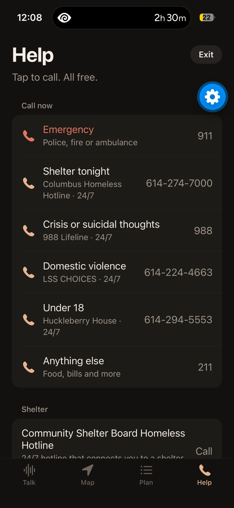

<div align="center">

# NorthStar

**A voice-first mobile companion that helps people experiencing homelessness find help tonight and plan a path to stable housing.**

Built for Columbus, Ohio · iOS & Android · No account required


</div>

<table>
  <tr>
    <td align="center"></td>
    <td align="center"></td>
    <td align="center"></td>
    <td align="center"></td>
    <td align="center"></td>
  </tr>
  <tr>
    <td align="center"><b>Talk</b></td>
    <td align="center" colspan="2"><b>Map</b></td>
    <td align="center"><b>Plan</b></td>
    <td align="center"><b>Help</b></td>
  </tr>
</table>

## The problem

People experiencing homelessness often have an old phone, a cracked screen, limited data and little time. Most resource directories assume the opposite: long web forms, accounts, dense text. NorthStar is designed around that reality: you can **talk** instead of type, get **one clear arrow** to the nearest shelter instead of a list of 40 pins, and follow **one next step** instead of navigating a maze of agencies.

## Features

| | |
| --- | --- |
| 🎙️ **Talk** | A voice assistant. Tap, speak, and it answers out loud in a calm, natural voice. Speech-to-text, LLM reply and text-to-speech run end to end in a few seconds. |
| 🧭 **Map** | A walking-direction arrow (in the style of a "find my" device locator) that points to the nearest shelter, food, warm place, water, restroom or clinic, with distance, walk time and one-tap directions. |
| ✅ **Plan** | A personalized roadmap to housing (mailing address → ID → benefits → income → housing), built from a few yes/no questions. Steps unlock as their prerequisites are done, with guides for SNAP, Medicaid and a State ID. |
| 📞 **Help** | Tap-to-call 24/7 crisis lines and local resources, all free. |
| 🚪 **Quick exit** | Every screen has an **Exit** button that instantly switches to a harmless weather page, for someone who needs to hide what they're looking at. |
| 🔐 **Private by design** | No accounts, no server-side user data. Progress lives on the device, and a short **recovery code** restores your plan on a new phone. |

## Engineering highlights

- **Dependency-graph roadmap.** Each plan step declares `requires` (prerequisite steps) and `skipIf` (a questionnaire answer that marks it as already done). The app resolves every step to *done / next / locked*, so someone who already has an ID skips straight past "Prove Who You Are."
- **Serverless account recovery.** The user's answers and completed steps are packed into a bitfield, encoded in base-36 with a version prefix and a checksum character (e.g. `NS1-4K7Q`). The code itself *is* the backup: nothing is stored on a server, and typos are caught before a wrong plan is restored.
- **Low-latency voice pipeline.** Audio goes to an Expo Router API route → ElevenLabs Scribe (speech-to-text) → Groq-hosted `gpt-oss-120b` → ElevenLabs Flash v2.5 streamed back as speech. API keys stay server-side.
- **Grounded answers.** The assistant's system prompt is generated from the app's own resource and benefits data, so it only gives out phone numbers the app actually lists, instead of inventing them.
- **Offline-friendly places data.** Shelters, food, water, restrooms and clinics are pulled from OpenStreetMap by a script and bundled with the app, so the map arrow works on a weak connection.

## Architecture

```
┌──────────────────────── Phone (Expo / React Native) ────────────────────────┐
│  Talk ── record audio ──┐        Map ── expo-location + bundled OSM places  │
│                         │        Plan ── roadmap.ts (dependency graph)      │
│                         │        Help ── tap-to-call resources              │
│                         │        AsyncStorage ── answers, progress, lists   │
└─────────────────────────┼───────────────────────────────────────────────────┘
                          ▼
            Expo Router API routes (server)
            /api/talk  ── ElevenLabs STT ──► Groq LLM ──► reply text
            /api/speak ── ElevenLabs TTS (streamed audio)
            /api/places ── nearby place search
```

## Tech stack

| Layer | Tools |
| --- | --- |
| App | Expo SDK 58, React Native, Expo Router, TypeScript, Reanimated |
| Maps & location | react-native-maps, expo-location, OpenStreetMap (Overpass) |
| Voice | expo-audio, ElevenLabs Scribe (STT) & Flash v2.5 (TTS) |
| AI | Groq (`openai/gpt-oss-120b`) |
| Storage | AsyncStorage (on-device only) |

## Getting started

**Prerequisites:** Node.js 20+, and the [Expo Go](https://expo.dev/go) app on your phone.

```bash
git clone https://github.com/MukaNarangarav/northstar.git
cd northstar
npm install
cp .env.example .env    # add your API keys (see below)
npx expo start
```

Scan the QR code with Expo Go. If your network blocks it (common on school or work Wi-Fi), use a tunnel:

```bash
npm install --no-save @expo/ngrok@^4.1.0
npx expo start --tunnel ngrok
```

### Environment variables

Only the **Talk** tab needs keys. Both have free tiers.

| Variable | Where to get it |
| --- | --- |
| `GROQ_API_KEY` | [console.groq.com](https://console.groq.com) → API Keys |
| `ELEVENLABS_API_KEY` | [elevenlabs.io](https://elevenlabs.io) → Profile → API Keys |

`.env` is git-ignored. Never commit it.

## Project structure

```
src/
├── app/
│   ├── (tabs)/            # Talk (index), Map, Plan, Help
│   ├── api/               # Server routes: talk, speak, places
│   ├── step/[id].tsx      # Plan step detail
│   ├── benefit/[id].tsx   # SNAP / Medicaid / State ID guides
│   ├── questionnaire.tsx  # Yes/no onboarding questions
│   └── restore.tsx        # Enter a recovery code
├── components/            # Orb (animated voice orb), shared UI kit
├── data/                  # steps, resources, benefits, places (JSON)
├── lib/                   # roadmap, recovery codes, geo, profile storage
└── server/prompt.ts       # Voice assistant system prompt
scripts/fetch-places.mjs   # Refresh map places from OpenStreetMap
```

## Content & data

- **Plan steps** live in `src/data/steps.json`. Changing questions or steps changes the recovery-code layout, so bump `CODE_VERSION` in `src/lib/recovery.ts` when you do.
- **Resources** in `src/data/resources.json` can include `address`, `hours` and `serves`. When `address` is set, the row offers Directions. Only add details you've confirmed.
- **Map places** come from OpenStreetMap and currently cover central Columbus. Run `node scripts/fetch-places.mjs` to refresh or widen the area.

## Roadmap

- [ ] Verify every phone number and link with the providers
- [ ] Add hours and eligibility to every resource
- [ ] Expand map coverage beyond central Columbus
- [ ] Spanish and Somali translations by professional translators

## Acknowledgements

Map data © [OpenStreetMap](https://www.openstreetmap.org/copyright) contributors, available under the ODbL. Crisis and shelter numbers are from the Community Shelter Board, LSS CHOICES, Huckleberry House and the 988 Suicide & Crisis Lifeline.

> NorthStar is not a substitute for emergency services. In an emergency, call **911**.
